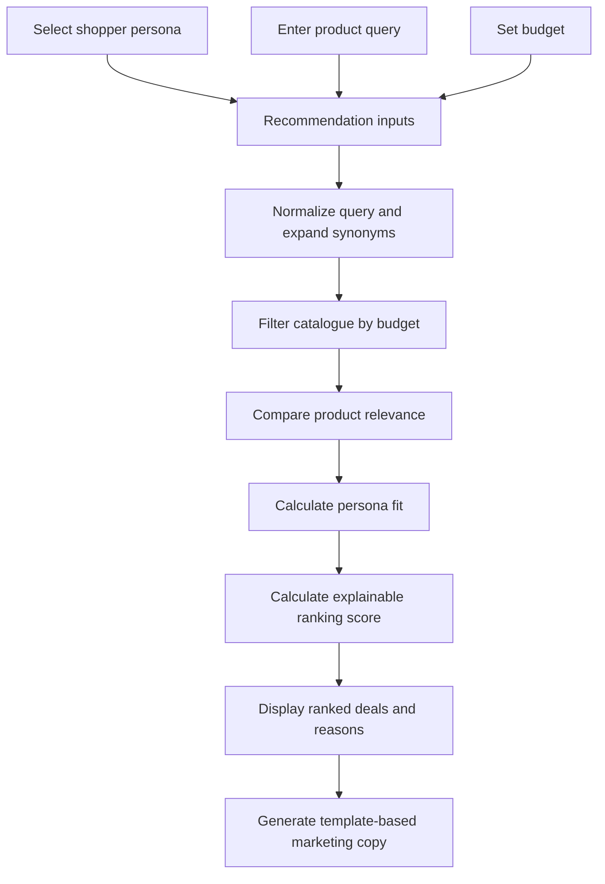

# AI Deal Discovery & Marketing Agent

A Streamlit portfolio prototype from **AakankshLabs** exploring product search, shopper personas, budget fit, explainable recommendations, and marketing content workflows.

> **Project status: Early prototype.** The recommender is deterministic and rule-based. It uses a structured catalogue of 100 synthetic sample products; it is not connected to live retailer inventory and does not use an LLM or a trained machine-learning model.

## Current features

- Seven selectable shopper personas with explicit needs and priorities.
- Structured 100-product synthetic catalogue stored separately from the interface.
- Free-text product query and adjustable budget.
- Synonym-aware search (for example, headphones can match a headset).
- Budget filtering and persona-aware ranking.
- Explainable match score, component-level score breakdown, and human-readable recommendation reasons.
- Per-product relevant / not relevant feedback controls.
- Session-only search and feedback analytics with CSV export (no server-side persistence).
- Illustrative price, discount, and savings calculations.
- Template-based Instagram, push notification, email, and SEO copy.

## Shopper personas

Personas are product-design hypotheses that help demonstrate how preferences can affect ranking. They are not verified demographic research, and the application does not infer sensitive attributes or build profiles from personal data.

| Persona | Main needs | Example category interests |
|---|---|---|
| Budget-conscious student | Affordable campus essentials and everyday utility | Student essentials, fashion, electronics |
| Campus style seeker | Style relevance and wearable value | Fashion, footwear, accessories |
| Competitive gamer | Gaming peripherals and useful performance features | Gaming, electronics, audio |
| Casual gamer and streamer | Accessible gaming, audio, and creator accessories | Gaming, audio, creator gear |
| Tech enthusiast | Useful gadgets, features, and technology relevance | Electronics, audio, gadgets |
| Value-first everyday shopper | Practical utility and a balance of price and savings | Home, fashion, electronics, footwear |
| Fitness and active lifestyle shopper | Products for exercise and an active routine | Fitness, footwear, fashion |

These personas are initial hypotheses for a prototype. They should be validated with user interviews, behavioural data, or survey research before being treated as real customer segments.

## Recommendation engine: version 2

The recommendation logic lives in `recommendations.py`, separate from the Streamlit interface.

### Ranking approach

1. Normalize the search query into lowercase tokens.
2. Expand known synonyms.
3. Exclude products outside the selected budget.
4. Require every query term to match directly or through its synonym group, preventing partial multi-word matches (for example, a mouse pad is not returned for “gaming keyboard”).
5. Calculate query relevance from matched terms.
6. Compare product categories and audience tags with the selected persona.
7. Combine relevance, persona fit, budget fit, and illustrative discount into a transparent score.
8. Return ranked products with human-readable explanations.

For persona-aware searches, the heuristic score is:

```text
score = 60% × query relevance
      + 20% × persona fit
      + 12% × budget fit
      +  8% × illustrative discount
```

A small exact-name bonus may also apply. Persona fit is based on explicitly assigned product categories and tags. The score is not a probability, confidence level, or measured recommendation accuracy.

### Flow



## Project structure

```text
ai-deal-agent/
├── app.py
├── data/
│   └── products.json
├── recommendations.py
├── requirements.txt
├── README.md
├── docs/
│   └── DEPLOYMENT.md
└── tests/
    ├── test_recommendations.py
    └── test_catalogue.py
```

## Sample catalogue data model

The catalogue is stored in `data/products.json` and includes a stable sample ID, product name, brand label, category, subcategory, description, INR price, illustrative reference price, features, keywords, persona tags, sample seller label, sample-only availability, and a data disclaimer. All records are synthetic and must not be represented as live products or offers.

## Tech stack

- **Python** — application and recommendation logic
- **Streamlit** — interactive interface
- **unittest** — automated recommendation and catalogue validation tests using Python's standard library

## Run locally

```bash
git clone https://github.com/AakankshLabs/ai-deal-agent.git
cd ai-deal-agent
python -m venv .venv
```

Windows PowerShell activation:

```powershell
.venv\Scripts\Activate.ps1
```

macOS / Linux activation:

```bash
source .venv/bin/activate
```

Install and launch:

```bash
pip install -r requirements.txt
streamlit run app.py
```

Run automated tests:

```bash
python -m unittest discover -s tests -v
```

## Feedback and analytics

Users can mark recommendations as relevant or not relevant. Search counts and feedback totals are summarized in a session analytics panel, with an optional CSV export. These events are held only in Streamlit session state: they are not sent to a database, retained across sessions, or used to train the recommender. The score breakdown shows the heuristic contribution points so users can understand the ranking; it is not a probability or confidence estimate.

## Deployment

The app is structured for deployment on Streamlit Community Cloud. Follow the step-by-step instructions in [`docs/DEPLOYMENT.md`](docs/DEPLOYMENT.md). Deployment has not yet been performed; the repository's CI passing does not mean a hosted app is live.

## Current limitations

- The catalogue contains 100 synthetic sample records in `data/products.json`; it is not a real retailer feed.
- Persona profiles and preferences are manually authored hypotheses.
- Product category and persona tags are manually assigned.
- Synonym matching is limited to a small dictionary.
- Ranking weights are heuristic and have not been evaluated against labelled user feedback.
- The audience persona affects ranking, but there is no persistent user profile or behavioural personalization.
- Prices, sellers, discounts, and images are illustrative sample data.
- Marketing messages are fixed templates, not LLM-generated copy.
- No user accounts, checkout, retailer API, or live inventory validation are included.

## Roadmap

- [x] Separate recommendation logic from the Streamlit interface.
- [x] Add synonym-aware matching and explainable ranking.
- [x] Add automated unit tests for the baseline recommender.
- [x] Add detailed personas and persona-aware ranking.
- [x] Move the 100-product sample catalogue into a versioned JSON data source.
- [x] Add catalogue schema, uniqueness, and sample-data validation tests.
- [ ] Validate persona hypotheses with user research.
- [ ] Evaluate ranking against a labelled test set and tune weights.
- [ ] Explore semantic search with embeddings.
- [ ] Connect a trusted product feed and validate offer freshness.
- [ ] Add an optional LLM-assisted copywriting feature with human review.
- [x] Add session-only recommendation feedback and analytics export.
- [x] Show transparent score component breakdowns.
- [x] Document the Streamlit Community Cloud deployment process.
- [ ] Deploy and run external usability testing.

## Product foundation (v0.2)

The repository now includes planning and engineering documents for the next stage. These describe the target design; they do not imply that the future backend, database, live feeds, or merchant portal have already been implemented.

- [Product requirements](docs/PRODUCT_REQUIREMENTS.md)
- [Proposed architecture](docs/ARCHITECTURE.md)
- [Product data and trust policy](docs/DATA_POLICY.md)
- [Search and recommendation evaluation plan](docs/EVALUATION_PLAN.md)
- [Initial database design](docs/DATABASE_DESIGN.md)
- [Local environment template](.env.example)

The next implementation gate is to validate the initial customer/category hypothesis and obtain an authorized product-data source before connecting live offers. Keep synthetic sample records clearly labelled.

## Portfolio context

This project demonstrates an early product concept at the intersection of **deal discovery, customer segmentation, recommendation logic, and marketing content workflows**.

**Areas explored:** product thinking, persona design, Python, Streamlit, text normalization, synonym mapping, heuristic ranking, explainability, and unit testing.

## About AakankshLabs

AakankshLabs is a portfolio space for experiments in digital products, analytics, and AI-enabled business workflows.

---

*For demonstration only. Confirm actual seller, price, stock, and offer terms independently before making a purchase.*
