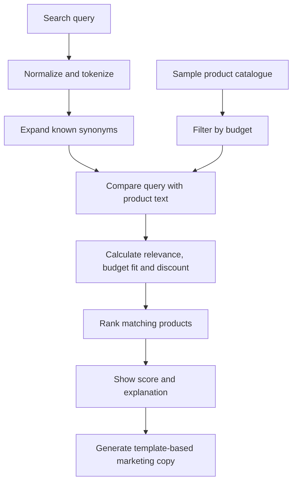

# AI Deal Discovery & Marketing Agent

A Streamlit portfolio prototype from **AakankshLabs** exploring how product search, a shopper's audience segment, and a spending limit can be combined into a deal-discovery experience.

> **Project status: Early prototype.** The current recommender is deterministic and rule-based. It uses a small illustrative catalogue; it is not connected to live retailer inventory and does not use an LLM or a trained machine-learning model.

## Problem being explored

Shoppers often need to narrow product options by what they want and what they can spend. Marketers also need concise promotional messages for different channels. This prototype brings those tasks into one demonstration: recommend matching sample products within a budget, explain the ranking, and draft basic promotional copy for the top result.

## Current features

- Audience selection for student, gamer, or shopper.
- Free-text product query and adjustable budget.
- Basic synonym-aware search (for example, headphones can match a headset).
- Budget filtering and ranked product recommendations.
- An explainable match score and human-readable reasons for each result.
- Sample price, reference price, illustrative discount, and estimated savings.
- Template-based Instagram, push notification, email, and SEO copy.

## Recommendation engine: version 1

The recommendation logic lives in `recommendations.py`, separate from the Streamlit interface.

### Ranking approach

1. **Normalize the query:** convert it to lowercase alphanumeric tokens.
2. **Expand related terms:** use a small, explicit synonym dictionary.
3. **Filter by budget:** exclude products priced above the user's budget.
4. **Measure relevance:** calculate the proportion of query tokens represented in the product name or keywords.
5. **Calculate supporting signals:** budget fit and illustrative discount.
6. **Rank and explain:** return a score and reasons for each recommendation.

The current score is a transparent heuristic:

```text
score = 75% × query relevance
      + 15% × budget fit
      + 10% × illustrative discount
```

A small exact-name bonus may also apply. The score is a ranking aid, not a probability, confidence level, or measured recommendation accuracy.

### Flow



## Example user journey

1. Select an audience segment, such as **student**.
2. Search for **headphones**.
3. Set a maximum budget, such as **₹3,000**.
4. Select **Find recommended deals**.
5. Review the matching sample product, its score, and the explanation.

The sample catalogue and prices are illustrative. They are not live commercial offers.

## Project structure

```text
ai-deal-agent/
├── app.py
├── recommendations.py
├── requirements.txt
├── README.md
└── tests/
    └── test_recommendations.py
```

## Tech stack

- **Python** — application and recommendation logic
- **Streamlit** — interactive interface
- **unittest** — automated tests using Python's standard library

## Run locally

1. Clone the repository:

   ```bash
   git clone https://github.com/AakankshLabs/ai-deal-agent.git
   cd ai-deal-agent
   ```

2. (Recommended) Create and activate a virtual environment:

   ```bash
   python -m venv .venv
   ```

   Windows PowerShell:

   ```powershell
   .venv\Scripts\Activate.ps1
   ```

   macOS / Linux:

   ```bash
   source .venv/bin/activate
   ```

3. Install dependencies and run the application:

   ```bash
   pip install -r requirements.txt
   streamlit run app.py
   ```

4. Run the automated tests from the repository root:

   ```bash
   python -m unittest discover -s tests -v
   ```

## Current limitations

- The product catalogue is hard-coded in `app.py` and contains only a few examples.
- Synonyms are manually defined and do not provide broad language understanding.
- Matching uses tokens and keyword overlap, not embeddings or semantic search.
- Ranking weights are heuristic and have not been tuned against user behaviour or relevance labels.
- Audience selection is displayed as context; it does not yet personalize ranking.
- Prices, sellers, discounts, and images are illustrative sample data.
- Marketing messages are fixed templates, not LLM-generated copy.
- No user accounts, persistent preferences, checkout, retailer API, or live inventory validation are included.

## Roadmap

- [x] Separate recommendation logic from the Streamlit interface.
- [x] Add basic synonym-aware matching and explainable ranking.
- [x] Add automated unit tests for the baseline recommender.
- [ ] Move the sample catalogue into a structured data source.
- [ ] Add category metadata and meaningful audience-specific ranking.
- [ ] Evaluate ranking against a labelled test set and tune weights.
- [ ] Explore semantic search with embeddings.
- [ ] Connect a trusted product feed and validate offer freshness.
- [ ] Add an optional LLM-assisted copywriting feature with human review.
- [ ] Add deployment, monitoring, and privacy documentation.

## Portfolio context

This project demonstrates an early product concept at the intersection of **deal discovery, audience segmentation, and marketing content workflows**. The current version is useful as a transparent baseline before introducing more advanced recommendation methods.

**Areas explored:** product thinking, user-input design, Python, Streamlit, text normalization, synonym mapping, heuristic ranking, explainability, and unit testing.

## About AakankshLabs

AakankshLabs is a portfolio space for experiments in digital products, analytics, and AI-enabled business workflows.

---

*For demonstration only. Confirm actual seller, price, stock, and offer terms independently before making a purchase.*
