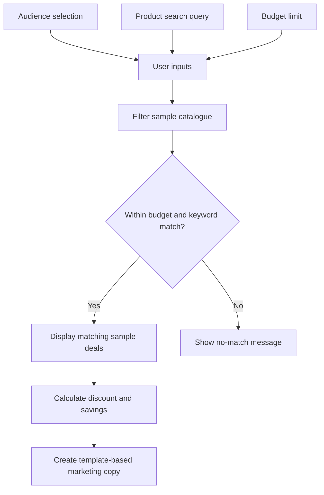

# AI Deal Discovery & Marketing Agent

A Streamlit portfolio prototype from **AakankshLabs** exploring how product search, a shopper's audience segment, and a spending limit can be combined into a simple deal-discovery experience.

<blockquote>
<strong>Project status: Early prototype</strong><br>
This version uses a small, hard-coded sample catalogue and deterministic keyword matching. It is not connected to live retailer inventory and does not use an LLM or machine-learning recommendation model. The word “AI” describes the intended product direction, not the current implementation.
</blockquote>

## Problem being explored

Shoppers often need to narrow product options by what they want and what they can spend. Marketers also need concise promotional messages for different channels. This prototype brings those two tasks into one small demonstration: find sample products that match a query and budget, then draft basic promotional copy for the first match.

## What the prototype currently does

- Lets a visitor choose a **student**, **gamer**, or **shopper** audience segment.
- Accepts a free-text product query and a budget between ₹500 and ₹5,000.
- Checks a small embedded catalogue for products within budget and matching keywords.
- Displays sample prices, reference prices, discount percentages, and estimated savings.
- Produces simple Instagram, push-notification, email, and SEO copy from fixed text templates.
- Displays the selected audience segment as a basic marketing context.

## Example user journey

1. Select an audience segment, such as **student**.
2. Enter a product query, such as **shirt**.
3. Set a maximum budget, such as **₹2,000**.
4. Select **Generate Smart Deal**.
5. Review the matching sample products and the promotional copy generated for the first match.

The catalogue is illustrative. Product names, sellers, prices, discounts, and image URLs are not live commercial offers.

## How it works



### Current matching and calculations

- **Budget check:** a product is eligible when its sample price is less than or equal to the selected budget.
- **Keyword check:** a product is included when any keyword stored for that product appears in the lowercased search text.
- **Discount percentage:** `(original price - current price) / original price × 100`.
- **Estimated savings:** `original price - current price`.

This is a transparent rule-based baseline, not semantic search, personalized ranking, or a predictive model.

## Tech stack

- **Python** — application logic and sample catalogue
- **Streamlit** — interactive web interface

## Run locally

1. Clone the repository:

   ```bash
   git clone https://github.com/AakankshLabs/ai-deal-agent.git
   cd ai-deal-agent
   ```

2. (Recommended) Create and activate a virtual environment:

   ```bash
   python -m venv .venv
   ```

   Windows PowerShell:

   ```powershell
   .venv\Scripts\Activate.ps1
   ```

   macOS / Linux:

   ```bash
   source .venv/bin/activate
   ```

3. Install dependencies and launch:

   ```bash
   pip install -r requirements.txt
   streamlit run app.py
   ```

## Current limitations

- The product catalogue is hard-coded in `app.py` and contains only a few examples.
- Matching uses simple substring checks against manually assigned keywords.
- The audience selection is displayed as context; it does not currently change the matching or ranking logic.
- Prices, sellers, discounts, and images are illustrative sample data.
- Marketing messages are fixed templates with product details inserted; they are not generated by a language model.
- There is no account system, persistent user profile, checkout, payment flow, retailer API, or live inventory validation.
- The prototype has not been presented as a production-ready recommendation system.

## Development roadmap

- [ ] Separate the product catalogue from the application code.
- [ ] Improve text normalization, token matching, and category handling.
- [ ] Add explainable ranking based on query relevance, budget fit, and user preferences.
- [ ] Make audience segments meaningfully affect recommendations and message tone.
- [ ] Connect a trusted product feed and validate offer freshness before displaying deals.
- [ ] Add an optional LLM-assisted copywriting feature with human review and clear safeguards.
- [ ] Add automated tests, error handling, and deployment documentation.

## Portfolio context

This project demonstrates an early product concept at the intersection of **deal discovery, audience segmentation, and marketing content workflows**. It can be discussed as a prototype exercise in translating a marketing problem into a simple interactive product flow, defining a baseline matching approach, and identifying the next technical steps.

**Areas explored:** product thinking, user-input design, budget-based filtering, basic Python application logic, Streamlit, and marketing communication.

## About AakankshLabs

AakankshLabs is a portfolio space for experiments in digital products, analytics, and AI-enabled business workflows.

---

*For demonstration only. Confirm actual seller, price, stock, and offer terms independently before making a purchase.*
