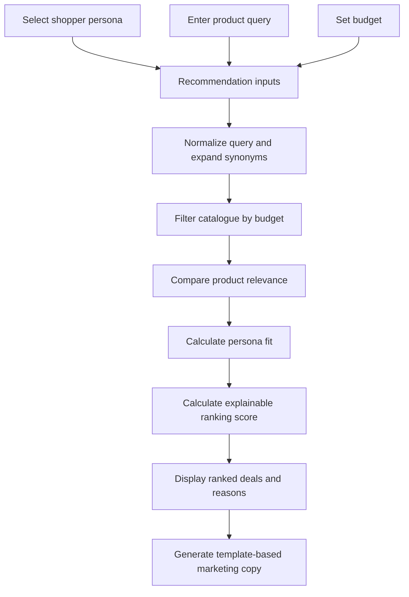

# AI Deal Discovery & Marketing Agent

A Streamlit portfolio prototype from **AakankshLabs** exploring product search, shopper personas, budget fit, explainable recommendations, and marketing content workflows.

> **Project status: Early prototype.** The recommender is deterministic and rule-based. It uses a small illustrative catalogue; it is not connected to live retailer inventory and does not use an LLM or a trained machine-learning model.

## Current features

- Seven selectable shopper personas with explicit needs and priorities.
- Free-text product query and adjustable budget.
- Synonym-aware search (for example, headphones can match a headset).
- Budget filtering and persona-aware ranking.
- Explainable match score and human-readable recommendation reasons.
- Illustrative price, discount, and savings calculations.
- Template-based Instagram, push notification, email, and SEO copy.

## Shopper personas

Personas are product-design hypotheses that help demonstrate how preferences can affect ranking. They are not verified demographic research, and the application does not infer sensitive attributes or build profiles from personal data.

| Persona | Main needs | Example category interests |
|---|---|---|
| Budget-conscious student | Affordable campus essentials and everyday utility | Student essentials, fashion, electronics |
| Campus style seeker | Style relevance and wearable value | Fashion, footwear, accessories |
| Competitive gamer | Gaming peripherals and useful performance features | Gaming, electronics, audio |
| Casual gamer and streamer | Accessible gaming, audio, and creator accessories | Gaming, audio, creator gear |
| Tech enthusiast | Useful gadgets, features, and technology relevance | Electronics, audio, gadgets |
| Value-first everyday shopper | Practical utility and a balance of price and savings | Home, fashion, electronics, footwear |
| Fitness and active lifestyle shopper | Products for exercise and an active routine | Fitness, footwear, fashion |

These personas are initial hypotheses for a prototype. They should be validated with user interviews, behavioural data, or survey research before being treated as real customer segments.

## Recommendation engine: version 2

The recommendation logic lives in `recommendations.py`, separate from the Streamlit interface.

### Ranking approach

1. Normalize the search query into lowercase tokens.
2. Expand known synonyms.
3. Exclude products outside the selected budget.
4. Calculate query relevance from matched terms.
5. Compare product categories and audience tags with the selected persona.
6. Combine relevance, persona fit, budget fit, and illustrative discount into a transparent score.
7. Return ranked products with human-readable explanations.

For persona-aware searches, the heuristic score is:

```text
score = 60% × query relevance
      + 20% × persona fit
      + 12% × budget fit
      +  8% × illustrative discount
```

A small exact-name bonus may also apply. Persona fit is based on explicitly assigned product categories and tags. The score is not a probability, confidence level, or measured recommendation accuracy.

### Flow



## Project structure

```text
ai-deal-agent/
├── app.py
├── recommendations.py
├── requirements.txt
├── README.md
└── tests/
    └── test_recommendations.py
```

## Tech stack

- **Python** — application and recommendation logic
- **Streamlit** — interactive interface
- **unittest** — automated tests using Python's standard library

## Run locally

```bash
git clone https://github.com/AakankshLabs/ai-deal-agent.git
cd ai-deal-agent
python -m venv .venv
```

Windows PowerShell activation:

```powershell
.venv\Scripts\Activate.ps1
```

macOS / Linux activation:

```bash
source .venv/bin/activate
```

Install and launch:

```bash
pip install -r requirements.txt
streamlit run app.py
```

Run automated tests:

```bash
python -m unittest discover -s tests -v
```

## Current limitations

- The catalogue is small and hard-coded in `app.py`.
- Persona profiles and preferences are manually authored hypotheses.
- Product category and persona tags are manually assigned.
- Synonym matching is limited to a small dictionary.
- Ranking weights are heuristic and have not been evaluated against labelled user feedback.
- The audience persona affects ranking, but there is no persistent user profile or behavioural personalization.
- Prices, sellers, discounts, and images are illustrative sample data.
- Marketing messages are fixed templates, not LLM-generated copy.
- No user accounts, checkout, retailer API, or live inventory validation are included.

## Roadmap

- [x] Separate recommendation logic from the Streamlit interface.
- [x] Add synonym-aware matching and explainable ranking.
- [x] Add automated unit tests for the baseline recommender.
- [x] Add detailed personas and persona-aware ranking.
- [ ] Move the sample catalogue into a structured data source.
- [ ] Validate persona hypotheses with user research.
- [ ] Evaluate ranking against a labelled test set and tune weights.
- [ ] Explore semantic search with embeddings.
- [ ] Connect a trusted product feed and validate offer freshness.
- [ ] Add an optional LLM-assisted copywriting feature with human review.
- [ ] Add deployment, monitoring, and privacy documentation.

## Portfolio context

This project demonstrates an early product concept at the intersection of **deal discovery, customer segmentation, recommendation logic, and marketing content workflows**.

**Areas explored:** product thinking, persona design, Python, Streamlit, text normalization, synonym mapping, heuristic ranking, explainability, and unit testing.

## About AakankshLabs

AakankshLabs is a portfolio space for experiments in digital products, analytics, and AI-enabled business workflows.

---

*For demonstration only. Confirm actual seller, price, stock, and offer terms independently before making a purchase.*
