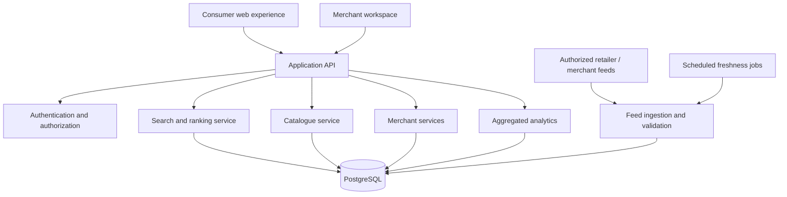

# Proposed Architecture

**Status:** Target architecture; not yet implemented.  
**Principle:** modular monolith first. Avoid microservices until real scale or team boundaries justify them.

## 1. Current system

The repository currently contains:
- Streamlit user interface in `app.py`.
- Deterministic, rule-based recommendation logic in `recommendations.py`.
- 100 synthetic sample products in `data/products.json`.
- Python unit, catalogue, relevance and browser smoke tests.
- GitHub Actions workflows.

The current app is a prototype. It has no live retailer feed, persistent database, user authentication, production LLM or trained recommender.

## 2. Target logical components



## 3. Technology direction

| Layer | Proposed technology | Reason |
|---|---|---|
| Existing prototype | Streamlit + Python | Preserve working baseline |
| Future consumer/merchant UI | Next.js + TypeScript | Shared web platform |
| API | FastAPI + Python | Typed APIs and Python ecosystem |
| Primary database | PostgreSQL | Relational integrity and mature operations |
| Semantic retrieval (later) | pgvector | Keep vectors near product data initially |
| Background jobs (later) | Python worker / scheduled job | Feed refresh and validation |
| Tests | unittest/pytest, Playwright | Unit, integration and browser coverage |
| CI | GitHub Actions | Automated quality gates |

No new infrastructure is required for v0.2. The technology choices are proposals and should be re-evaluated against actual costs, hosting terms and developer capability before implementation.

## 4. Suggested repository evolution

```text
ai-deal-agent/
├── app.py                         # Keep existing Streamlit prototype
├── recommendations.py             # Keep baseline recommender
├── data/
│   ├── products.json              # Clearly labelled synthetic fixture
│   └── schemas/
├── backend/
│   ├── app/
│   │   ├── api/
│   │   ├── core/
│   │   ├── models/
│   │   ├── schemas/
│   │   ├── services/
│   │   └── main.py
│   └── tests/
├── frontend/
│   ├── consumer/
│   └── merchant/
├── docs/
├── ml/
│   ├── evaluation/
│   ├── embeddings/
│   └── ranking/
├── tests/
└── .github/workflows/
```

Only add folders when a working feature needs them; do not create empty scaffolding just to make the repository look sophisticated.

## 5. Data flow

1. A source is approved and its usage rights are recorded.
2. A feed is fetched through an authorized API, merchant upload or licensed export.
3. Raw records are stored or logged according to retention policy.
4. Validation checks IDs, currency, prices, URLs, required attributes, duplicates and timestamps.
5. Valid records are normalized into the catalogue.
6. Search applies hard eligibility filters (such as budget and known stock state).
7. Ranking orders eligible results and returns reasons plus provenance.
8. The UI displays source and freshness information.
9. Feedback and events are collected only for disclosed purposes and retained according to policy.

## 6. Search evolution

### Baseline
Keep current deterministic keyword/synonym search as a reproducible fallback.

### Hybrid retrieval (later)
- PostgreSQL full-text search for exact terms.
- Embeddings for semantic similarity, only after data quality and evaluation are ready.
- Reciprocal-rank fusion or another benchmarked fusion method.
- Hard filters for budget, availability and required specifications.
- Reranking evaluated against a labelled query set.

### Conversational layer (later)
An LLM may parse shopper intent and explain trade-offs. It must not invent product facts. Product facts must be retrieved from validated records, and missing attributes must be stated explicitly.

## 7. Security boundaries

- Never commit API keys, database passwords, OAuth tokens or customer data.
- Use environment variables or a managed secret store.
- Apply role-based access control to merchant workspaces.
- Enforce tenant isolation for merchant-owned records.
- Do not expose raw consumer search histories to merchants.
- Validate file uploads and enforce size/type limits.
- Use parameterized database queries and safe output encoding.
- Define retention, deletion, backup and incident-response procedures before public accounts launch.

## 8. Architecture decision records

Any significant change should record:
- Context and problem.
- Options considered.
- Decision and rationale.
- Cost and operational consequences.
- Security/privacy implications.
- Reversal or migration plan.

## 9. Migration approach

1. Preserve Streamlit and its tests.
2. Add docs and contracts first.
3. Add backend independently, with its own tests.
4. Add database only when persistence is required.
5. Add a new frontend after API contracts stabilize.
6. Keep a rollback path to the Streamlit prototype until the new experience is proven.
