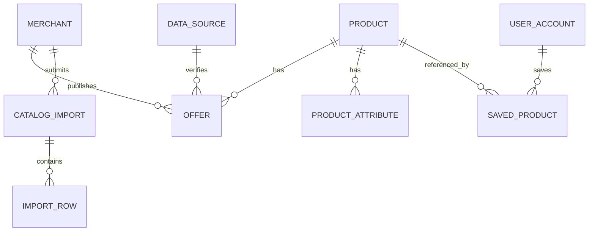

# Initial Database Design

**Status:** Proposed schema only. No database is provisioned by this document.  
**Target:** PostgreSQL.  
**Principle:** Separate canonical product facts from merchant-specific offers and source provenance.

## 1. Entity relationships



## 2. Core tables

### products
- id UUID primary key
- canonical_title text not null
- brand text nullable
- category text not null
- description text nullable
- attributes JSONB not null default '{}'
- created_at / updated_at timestamptz not null

### merchants
- id UUID primary key
- display_name text not null
- status text not null
- created_at / updated_at timestamptz not null

### data_sources
- id UUID primary key
- name text not null
- source_type text not null
- rights_status text not null
- permitted_fields JSONB not null
- reviewed_at timestamptz nullable
- created_at timestamptz not null

### offers
- id UUID primary key
- product_id UUID references products(id)
- merchant_id UUID references merchants(id)
- source_id UUID references data_sources(id)
- source_record_id text not null
- price_amount numeric(12,2) not null check (price_amount > 0)
- currency char(3) not null
- availability_status text not null
- product_url text not null
- last_verified_at timestamptz not null
- expires_at timestamptz nullable
- created_at / updated_at timestamptz not null
- unique(source_id, source_record_id)

### catalog_imports
- id UUID primary key
- merchant_id UUID references merchants(id)
- source_id UUID references data_sources(id)
- status text not null
- submitted_at timestamptz not null
- completed_at timestamptz nullable
- summary JSONB not null default '{}'

### saved_products (future, account feature)
- user_id UUID not null
- product_id UUID references products(id)
- created_at timestamptz not null
- primary key(user_id, product_id)

## 3. SQL starter migration

This is a design reference, not an instruction to run against a production database.

```sql
CREATE EXTENSION IF NOT EXISTS pgcrypto;

CREATE TABLE products (
    id uuid PRIMARY KEY DEFAULT gen_random_uuid(),
    canonical_title text NOT NULL,
    brand text,
    category text NOT NULL,
    description text,
    attributes jsonb NOT NULL DEFAULT '{}'::jsonb,
    created_at timestamptz NOT NULL DEFAULT now(),
    updated_at timestamptz NOT NULL DEFAULT now()
);

CREATE TABLE merchants (
    id uuid PRIMARY KEY DEFAULT gen_random_uuid(),
    display_name text NOT NULL,
    status text NOT NULL CHECK (status IN ('pending', 'active', 'suspended')),
    created_at timestamptz NOT NULL DEFAULT now(),
    updated_at timestamptz NOT NULL DEFAULT now()
);

CREATE TABLE data_sources (
    id uuid PRIMARY KEY DEFAULT gen_random_uuid(),
    name text NOT NULL,
    source_type text NOT NULL,
    rights_status text NOT NULL CHECK (rights_status IN ('pending_review', 'approved', 'revoked')),
    permitted_fields jsonb NOT NULL DEFAULT '[]'::jsonb,
    reviewed_at timestamptz,
    created_at timestamptz NOT NULL DEFAULT now()
);

CREATE TABLE offers (
    id uuid PRIMARY KEY DEFAULT gen_random_uuid(),
    product_id uuid NOT NULL REFERENCES products(id),
    merchant_id uuid NOT NULL REFERENCES merchants(id),
    source_id uuid NOT NULL REFERENCES data_sources(id),
    source_record_id text NOT NULL,
    price_amount numeric(12,2) NOT NULL CHECK (price_amount > 0),
    currency char(3) NOT NULL,
    availability_status text NOT NULL CHECK (availability_status IN ('in_stock', 'out_of_stock', 'unknown')),
    product_url text NOT NULL,
    last_verified_at timestamptz NOT NULL,
    expires_at timestamptz,
    created_at timestamptz NOT NULL DEFAULT now(),
    updated_at timestamptz NOT NULL DEFAULT now(),
    UNIQUE (source_id, source_record_id)
);

CREATE INDEX offers_product_idx ON offers(product_id);
CREATE INDEX offers_merchant_idx ON offers(merchant_id);
CREATE INDEX offers_freshness_idx ON offers(last_verified_at);
CREATE INDEX products_category_idx ON products(category);
```

## 4. Decisions still required

- Product matching and duplicate resolution rules.
- Merchant tenant ownership and authorization model.
- Account identity provider and consent model.
- Offer history and price tracking retention.
- Search indexes and optional vector storage.
- Deletion and audit requirements.
- Backup, recovery and migration policy.

Do not provision a database or store real user data until security, privacy, tenancy and operational requirements are reviewed.
